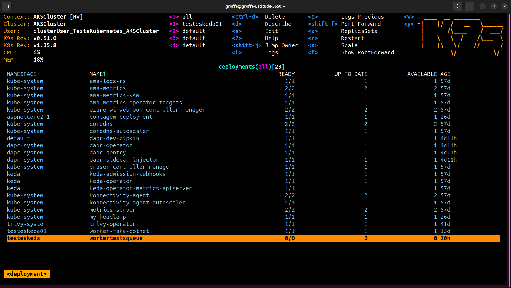
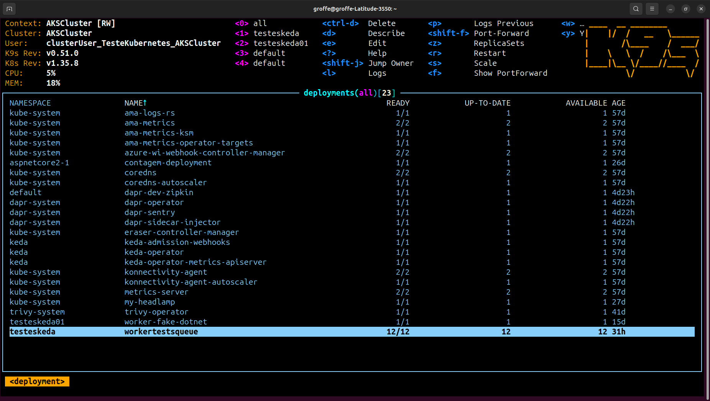
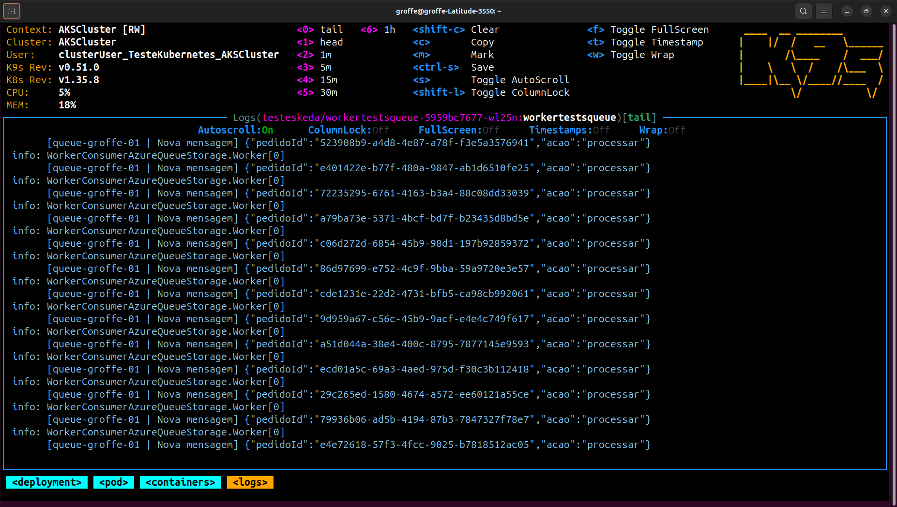

# kubernetes-keda-azurequeueatorage_consumergenerico
Objetos para Deployment de um Worker Service (consumer genérico) no Kubernetes utilizando KEDA, Azure Queue Storage e um Worker criado com .NET10. Foi definido 1 exemplo para ScaledObject (com cooldownPeriod).

Links importantes:
- Aplicação utilizada nos testes de escalabilidade: **https://github.com/renatogroffe/dotnet10-worker-azurequeuestorage_generic-consumer**
- Testes de carga com envio de mensagens em massa para uma fila do Azure Queue Storage: **https://github.com/renatogroffe/k6-loadtests-azuredevops-azurequeuestorage-html-dashboard**
- Instruções para configuração do KEDA e de sua integração com Grafana + Azure Managed Prometheus: **https://github.com/renatogroffe/keda_operator-aks-managed_prometheus**

Imagem que serviu de base para este exemplo:

```text
renatogroffe/dotnet10-worker-azurequeuestorage-consumer:1
```

## Testes

Aplicação antes de escalar:



Aplicação escalando:


Aplicação no momento em que atingiu o limite de escalabilidade:



Logs produzidos por um dos pods quando a aplicação escalou:

